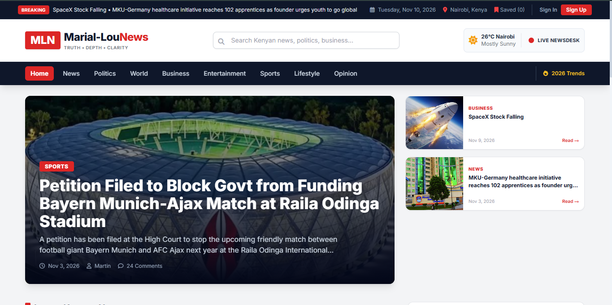

# Marial-LouNews (MLN)


Kenyan news portal: a static frontend served by an Express backend that stores
articles in Supabase, with editor and administrator consoles and an automated wire feed (RSS ingest).

```
backend/     Express API, session auth, RSS ingest worker (ESM)
frontend/    index.html (site), admin.html (editor console), administrator/ (admin console)
supabase/    schema.sql — idempotent DDL for all tables (safe to re-run)
```

## Run locally

```bash
cd backend
npm install
npm run dev
```

## Roles

| Role | Can do |
| --- | --- |
| `user` | Read the site, sign up and sign in |
| `editor` | Everything a reader can, plus write, publish/unpublish and delete their own articles |
| `administrator` | Full user management, wire feeds, and edit/delete of any article |

Editors work at `/editor`, administrators at `/administrator`. Both sign in through the same
form as readers; the server resolves the role and the consoles guard themselves.

Bootstrap the first administrator on a fresh database with
`npm run add-admin -- <email> <password> "<name>"`. After that, create readers, editors and
administrators from the Administrator Console (Accounts panel) — no script needed.

## Configuration

`backend/.env` (git-ignored; never commit real values):

| Variable | Purpose |
| --- | --- |
| `SUPABASE_URL` | Project URL |
| `SUPABASE_SERVICE_ROLE_KEY` | Server-only key, bypasses RLS |
| `SUPABASE_ANON_KEY` | Public key (reserved for per-user clients) |
| `JWT_SECRET` | Signs the `mln_session` cookie |
| `PORT` | Defaults to `3000` |
| `RSS_FETCH_CRON` | Ingest schedule, default `*/20 * * * *` |
| `RSS_RETENTION_DAYS` | Wire item retention, default `7` |

## Database

Run `supabase/schema.sql` in the Supabase SQL Editor. It creates `articles`, `admins`, `users`,
`rss_sources` and `rss_articles`, and upgrades older databases in place (`admins.role`,
`articles.created_by`, `articles.published`). Wire headlines are deduped per feed on
`(source_id, guid)`.

## API

Public — `GET /api/articles`, `GET /api/articles/:id` (published only), `POST /api/auth/signup`,
`POST /api/auth/login`, `GET /api/auth/me`, `POST /api/auth/logout`,
`GET /api/rss?source=&category=&q=&page=&limit=`, `GET /api/rss/sources`.

Staff (cookie session) — `GET /api/staff/articles` (own rows for editors), `POST /api/articles`,
`PUT /api/articles/:id` and `DELETE /api/articles/:id` (ownership enforced for editors).

Administrator — `/api/admin/users` (`GET/POST`, `PUT/DELETE /:id?role=<currentRole>`) and, under
`/api/admin/rss`: `GET/POST /sources`, `PUT/DELETE /sources/:id`, `POST /sources/:id/ingest`,
`POST /ingest`.

## Wire feed

`backend/rss-ingest.js` polls every active `rss_sources` row on a schedule (and on demand from
the Administrator Console) and stores short excerpts. The homepage renders them under
**From the Wire**; clicking a headline opens it on the site with the feed image, title, author,
date and excerpt, then the attribution line links readers to the publishing site. Add only feeds
whose publisher you are licensed to carry.
